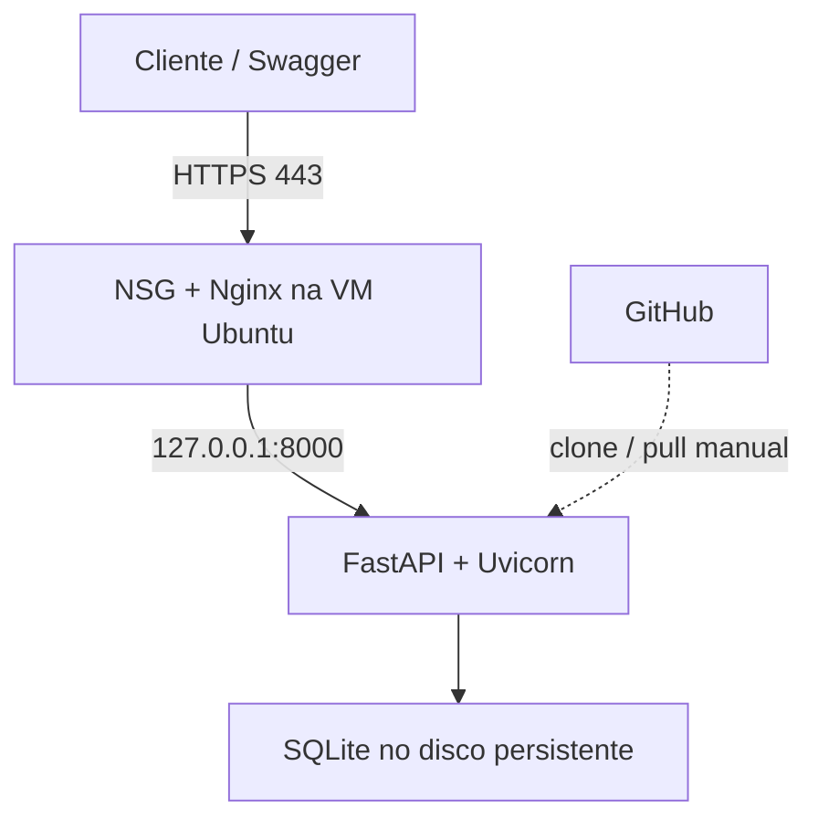
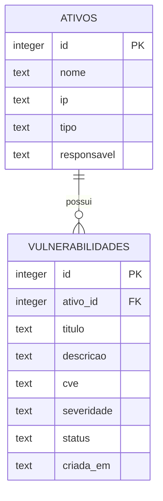

# VulnTrack — guia completo de implementação e entrega

Projeto acadêmico: API REST de gestão de vulnerabilidades com Python, FastAPI e SQLite, implantada em uma VM Ubuntu no Microsoft Azure. Este guia é um roteiro de execução; não é um relatório de implantação já realizada. Os testes locais do código foram executados, mas os recursos Azure, URL e GitHub precisam ser criados na sua conta.

## 1. Resultado esperado e escopo

Ao terminar, você terá uma URL HTTPS com `/docs`, uma API protegida por chave, um banco persistente, um repositório GitHub e evidências para um relatório Word/PDF. Não é necessário criar uma interface separada: o Swagger permite executar as operações pelo navegador.

O VulnTrack registra falhas informadas pela equipe. Ele não descobre vulnerabilidades, não varre hosts e não consulta CVEs automaticamente. A severidade é atribuída pelo usuário, sem cálculo automático de CVSS. Uma chave compartilhada basta para esta demonstração; não oferece contas individuais, RBAC ou trilha de auditoria.

Exemplo: cadastrar um servidor, registrar um achado, listar falhas abertas e atualizar o achado para corrigido. Use exclusivamente informações fictícias no ambiente público.

## 2. Tecnologias e papel de cada uma

| Tecnologia | Papel |
|---|---|
| Python 3.12 | Linguagem; disponível no Ubuntu 24.04 escolhido |
| FastAPI / Pydantic | Rotas, validação dos dados, OpenAPI e Swagger |
| Uvicorn | Processo que executa a aplicação Python |
| SQLite / sqlite3 | Banco relacional em arquivo, sem servidor de banco separado |
| Ubuntu Server 24.04 LTS x64 | Sistema operacional da VM |
| Azure Virtual Machines | Computação IaaS onde instalamos a aplicação |
| Disco gerenciado Standard SSD LRS | Sistema e arquivo do banco persistente |
| VNet, subnet e NIC | Rede privada e interface da VM |
| IP público Standard estático e DNS | Endereço público e nome para chegar à aplicação |
| NSG | Regras de entrada; 22 restrita ao seu IP e 80/443 públicas |
| Nginx | Recebe conexões web e encaminha à API em loopback |
| Certbot / Let's Encrypt | Certificado TLS e renovação para HTTPS |
| systemd | Inicia a API no boot e reinicia em caso de falha |
| Git / GitHub | Histórico do código e instruções reproduzíveis |

SKU significa a variante/tamanho de um recurso. Na VM define CPU e memória; no disco define a classe de armazenamento. Não confunda a SKU da VM com a SKU do IP ou do disco.

Não criaremos Azure SQL, PostgreSQL, Storage Account, Kubernetes ou API Management: o SQLite usa um arquivo no disco da VM. Um disco gerenciado já é um recurso de armazenamento Azure. Esta escolha reduz a quantidade de serviços para um trabalho básico.

## 3. Arquitetura e banco

O GitHub guarda o código; a VM executa uma cópia dele. Um push no GitHub não atualiza a VM automaticamente neste projeto.





Um ativo pode ter várias vulnerabilidades. Uma vulnerabilidade pertence a um ativo existente. Excluir um ativo com achados vinculados retorna 409: primeiro exclua os achados. A data de criação é gerada pela API em UTC. `cve` é opcional; não invente CVEs para achados sem identificador.

## 4. Onde executar cada coisa

| Ambiente | O que fazer |
|---|---|
| Seu Windows: navegador | Azure Portal, GitHub e Swagger |
| Seu Windows: VS Code | Abrir e editar a pasta do projeto |
| Seu Windows: PowerShell | Rodar localmente, testar, usar Git e iniciar SSH |
| VM: terminal SSH | Instalar dependências, configurar serviço, Nginx, HTTPS e backups |
| Word ou editor de documentos | Escrever relatório com resultados reais e capturas |

No terminal, `PS C:\...>` normalmente indica o Windows; `azureuser@...:~$` indica a VM. Não copie esses prefixos. Cada bloco abaixo informa onde executar. Comandos Bash com `sudo`, `export` e heredocs pertencem à VM, não ao PowerShell.

## 5. Preparar o computador

Instale Python 3.12, Git e VS Code pelos sites oficiais:

- https://www.python.org/downloads/
- https://git-scm.com/downloads
- https://code.visualstudio.com/

No instalador do Python, habilite a opção de adicionar ao PATH. Reabra o PowerShell após instalar. Verifique:

```powershell
py -3.12 --version
git --version
ssh -V
```

Se `ssh` não existir, habilite Cliente OpenSSH nos Recursos Opcionais do Windows. Não é preciso instalar Azure CLI, Docker ou Postman para seguir este roteiro.

Extraia o ZIP recebido. Mova a pasta `vulntrack` para, por exemplo, `C:\Projetos\vulntrack`. Abra essa pasta no VS Code. Os comandos seguintes assumem esse caminho; ajuste se usar outro.

Arquivos importantes: `main.py` implementa a API; `requirements.txt` define dependências de execução; `test_api.py` testa o fluxo; `deploy/` contém configurações para Linux; este README é o guia.

## 6. Rodar no Windows primeiro

**Onde: PowerShell do Windows, na pasta do projeto.**

```powershell
cd C:\Users\Desktop\Downloads\vulntrack
py -3.12 -m venv .venv
.\.venv\Scripts\python.exe -m pip install -r requirements-dev.txt
$env:VULNTRACK_API_KEY = & .\.venv\Scripts\python.exe -c "import secrets; print(secrets.token_urlsafe(32))"
$env:DATABASE_PATH = "data/vulntrack.db"
$env:VULNTRACK_API_KEY
.\.venv\Scripts\python.exe -m uvicorn main:app --reload --host 127.0.0.1 --port 8000
```

Copie a chave exibida para um local privado temporário. Ela só vale nessa sessão e não vai no código. A chamada direta ao Python da `.venv` dispensa ativação e evita problemas de política de execução do PowerShell. `--reload` é apenas para desenvolvimento local.

Abra http://127.0.0.1:8000/docs. Clique em **Authorize**, cole somente a chave, confirme e feche a janela. Agora use **Try it out** e **Execute** nas rotas.

Abra http://127.0.0.1:8000/health: deve responder `{"status":"ok"}`. Essa rota é pública. As rotas de dados exigem `X-API-Key`. O Swagger e o esquema OpenAPI são públicos, mas isso não libera os cadastros.

Para encerrar o servidor, pressione Ctrl+C no PowerShell. Se fechar o terminal, será necessário definir a variável da chave novamente antes de reiniciar. Os dados permanecem no arquivo, independentemente da chave.

## 7. Primeiro cadastro e fluxo de teste

No Swagger, execute `POST /ativos` com:

```json
{
  "nome": "Servidor Web de Homologacao",
  "ip": "10.0.0.10",
  "tipo": "servidor",
  "responsavel": "Equipe de Infraestrutura"
}
```

Espere HTTP 201. Anote o `id` retornado; use esse valor em `ativo_id` abaixo (o exemplo pressupõe 1). O IP é apenas um dado cadastral, não precisa ser o IP público da VM.

Execute `POST /vulnerabilidades`:

```json
{
  "ativo_id": 1,
  "titulo": "Divulgacao de versao no cabecalho HTTP",
  "descricao": "Cenario ficticio: o cabecalho X-Powered-By revela a versao do PHP. Tratamento proposto: remover o cabecalho e manter o runtime atualizado.",
  "cve": null,
  "severidade": "baixa",
  "status": "aberta"
}
```

É um exemplo didático de registro, não um achado comprovado na VM. Severidade baixa aqui é uma escolha ilustrativa, não uma avaliação CVSS.

Sequência de comprovação:

| Operação | Resultado esperado |
|---|---|
| POST /ativos | 201 e ID gerado |
| GET /ativos | 200 e lista com o ativo |
| GET /ativos/{id} | 200 e ativo específico |
| POST /vulnerabilidades | 201 e ID gerado |
| GET /vulnerabilidades?severidade=baixa&status=aberta | 200 e achado no filtro |
| GET /resumo | Totais e contagens coerentes |
| PUT /ativos/{id} | 200 após enviar todos os campos do ativo |
| PUT /vulnerabilidades/{id} | 200 após enviar todos os campos, com status corrigida |
| DELETE /ativos/{id} com achado vinculado | 409, bloqueio esperado |
| DELETE /vulnerabilidades/{id} | 204, sem corpo |
| DELETE /ativos/{id} após excluir o achado | 204, sem corpo |
| GET de ID excluído | 404 |
| Requisição de dados sem chave | 401 |
| POST com IP inválido ou severidade fora da lista | 422 |

`PUT` substitui os campos editáveis: envie o objeto completo. Não envie `id` ou `criada_em` no corpo. Não use `PATCH`: essa rota não foi implementada. Em `/resumo`, `abertas_por_severidade` soma aberta + em_tratamento; corrigidas ficam fora dessa contagem.

Para testar sem chave, clique em Authorize → Logout e execute GET /ativos. Depois autorize de novo.

Para os testes automáticos, abra outro PowerShell na pasta do projeto:

```powershell
.\.venv\Scripts\python.exe -m unittest -v
```

Resultado esperado: `OK`. O teste usa banco temporário, verifica autenticação, validação, relacionamento, CRUD, filtros, resumo e persistência ao reabrir a aplicação. Não modifica seu banco de demonstração.

## 8. Publicar o código no GitHub

**Onde: navegador do Windows.** Entre no GitHub e crie um repositório chamado `vulntrack`. Para facilitar o clone na VM, use público, com dados exclusivamente fictícios. Crie vazio, sem adicionar README pelo site, pois o projeto já tem um.

**Onde: PowerShell, pasta do projeto.** Substitua os campos em maiúsculas antes de executar:

```powershell
git init
git branch -M main
git config user.name "José Rodrigues"
git config user.email "SEU_EMAIL_DO_GITHUB"
git add .
git status
git diff --cached --stat
git commit -m "Implementa API VulnTrack com SQLite e guia Azure"
git remote add origin https://github.com/SEU_USUARIO/vulntrack.git
git push -u origin main
```

Faça o login quando o Git solicitar pelo navegador. A senha normal do GitHub não funciona como senha de push HTTPS. Use o fluxo de login do Git Credential Manager; não grave tokens no README ou na URL do remote.

Antes do commit, confirme que `.venv`, `data`, bancos, `.env`, chaves `.pem` e segredos não aparecem nos arquivos preparados. O `.gitignore` incluído já exclui esses itens. Ele não remove arquivos que já foram versionados: se houver exposição real de segredo, revogue/troque o segredo e remova-o do histórico conforme necessário.

Se o remote já existir, use `git remote -v` e corrija com `git remote set-url origin URL_REAL`. Não use `--force` para resolver divergências sem entender a causa.

## 9. Criar recursos no Azure

**Onde: navegador → https://portal.azure.com.** Confirme que tem uma assinatura ativa e acesso para criar VMs. Use sua assinatura acadêmica se disponível. Crédito e disponibilidade precisam ser conferidos na sua própria conta.

1. Pesquise **Grupos de recursos**, clique em Criar e use `rg-vulntrack`. É o agrupamento dos recursos deste trabalho.
2. Pesquise **Máquinas virtuais** → Criar → Máquina virtual do Azure.
3. Selecione a assinatura e `rg-vulntrack`.
4. Nome: `vm-vulntrack`. Região: escolha uma permitida pela assinatura e com tamanho disponível. Pode ser Brazil South, mas não é obrigatório.
5. Imagem: **Ubuntu Server 24.04 LTS, x64, Gen2**. Evite imagem ARM ao seguir este roteiro.
6. Disponibilidade: sem redundância adicional para o laboratório, se permitido. Não crie múltiplas VMs.
7. Tamanho: tente **Standard_B1s (1 vCPU, 1 GiB)** para a carga pequena. Se indisponível, escolha outra opção pequena x64 e registre o tamanho real. Não substitua silenciosamente por uma VM grande; confira a estimativa.
8. Autenticação: **chave pública SSH**; usuário `azureuser`; gere novo par, por exemplo `vulntrack-key`.
9. Disco do SO: **Standard SSD LRS**, aproximadamente 30–32 GiB se a imagem permitir. Use disco gerenciado persistente, não disco de SO efêmero. Não precisamos de disco de dados extra nem de disco Premium para o exercício.
10. Rede: crie/selecione uma VNet e subnet dentro do grupo; IP público **Standard estático**, associado à NIC. O endereço público associado também fornece conectividade de saída para instalações.
11. Nas regras de entrada, habilite SSH inicialmente. No NSG, restrinja a origem da porta 22 ao seu IP público /32. Adicione TCP 80 e 443 com origem Internet. Não abra 8000 nem uma porta de banco.
12. Revise o custo, o tamanho, os discos e extras. Bastion, NAT Gateway ou serviços adicionais não são necessários neste roteiro.
13. Clique em Examinar + criar, valide e crie. Baixe a chave privada quando solicitado e guarde fora do projeto; por exemplo em `C:\Users\SEU_USUARIO\Downloads\vulntrack-key.pem`.
14. Na visão geral da VM, copie o IP público e registre o tamanho real implantado.

Os rótulos do portal podem mudar. Use a função do campo como referência. Se houver bloqueio de SKU/quota/região, escolha região e tamanho autorizados e registre a alteração; não existe garantia de B1s disponível em toda conta.

No NSG vinculado à NIC ou subnet, confira regras equivalentes a:

| Prioridade sugerida | Origem | Porta TCP | Ação |
|---|---|---|---|
| 100 | Seu IP público/32 | 22 | Permitir |
| 110 | Internet | 80 | Permitir |
| 120 | Internet | 443 | Permitir |

Verifique se não existe outra regra anterior liberando 22 para qualquer origem. Se seu IP residencial mudar, atualize essa regra. Se usar UFW/firewall dentro do Ubuntu, ele também deve permitir essas portas; o NSG não substitui o firewall do sistema.

### DNS

Abra o recurso de IP público da VM → Configuração → rótulo DNS. Escolha um prefixo único, como `vulntrack-jose-XXXXX`, salve e copie o **FQDN completo exibido pelo Azure**. Pode haver sufixos adicionais em nomes protegidos; não tente adivinhar o nome.

Não é preciso comprar domínio nem criar uma zona Azure DNS. O nome do IP público é suficiente. Guarde quatro informações: IP público, FQDN, nome do grupo e caminho local da chave.

## 10. Entrar na VM por SSH

**Onde: PowerShell do Windows.** Troque o caminho e o IP pelos seus valores reais:

```powershell
ssh -i "C:\Users\SEU_USUARIO\Downloads\vulntrack-key.pem" azureuser@SEU_IP_PUBLICO
```

Na primeira conexão, confira a identidade do host usando o canal de administração da VM quando disponível e confirme a confiança. Não compartilhe nem envie a chave privada. Se aparecer `Permission denied`, confira usuário, chave selecionada e permissões do arquivo. Se der timeout, confira IP, VM ligada, NSG e seu IP de origem.

Depois da conexão, os próximos comandos são **Bash na VM**.

## 11. Instalar e copiar o projeto para a VM

```bash
sudo apt update
sudo apt install -y python3 python3-venv python3-pip git nginx sqlite3 certbot python3-certbot-nginx
sudo useradd --system --home-dir /opt/vulntrack --shell /usr/sbin/nologin vulntrack
sudo git clone https://github.com/SEU_USUARIO/vulntrack.git /opt/vulntrack
sudo python3 -m venv /opt/vulntrack/.venv
sudo /opt/vulntrack/.venv/bin/python -m pip install -r /opt/vulntrack/requirements.txt
sudo install -d -o vulntrack -g vulntrack -m 700 /var/lib/vulntrack
```

Substitua `SEU_USUARIO` no clone. Faça a criação do usuário somente uma vez. O código ficará sob administração de root, enquanto o serviço rodará como usuário dedicado, sem privilégios administrativos. O diretório gravável do banco é separado do código.

### Criar o segredo na VM

```bash
sudo sh -c 'umask 077; python3 - <<"PY" > /etc/vulntrack.env
import secrets
print("VULNTRACK_API_KEY=" + secrets.token_urlsafe(32))
print("DATABASE_PATH=/var/lib/vulntrack/vulntrack.db")
PY'
sudo chmod 600 /etc/vulntrack.env
```

A chave de nuvem é diferente da chave local. Para copiá-la de modo privado ao Swagger, consulte no seu terminal:

```bash
sudo cat /etc/vulntrack.env
```

Não capture essa tela para o relatório e não salve esse arquivo no Git. O systemd, como gerenciador, lê o arquivo protegido e passa as variáveis ao processo.

## 12. Registrar a API como serviço

```bash
sudo cp /opt/vulntrack/deploy/vulntrack.service /etc/systemd/system/vulntrack.service
sudo systemctl daemon-reload
sudo systemctl enable --now vulntrack
sudo systemctl status vulntrack --no-pager
curl -i http://127.0.0.1:8000/health
```

Espere `active (running)` e HTTP 200. O serviço usa **um worker** e escuta apenas em `127.0.0.1:8000`; acesso externo passa pelo Nginx. O banco será criado em `/var/lib/vulntrack/vulntrack.db`, no disco do SO persistente, fora do repositório. Não use `/tmp` nem disco temporário da VM para armazená-lo.

Se houver falha:

```bash
sudo journalctl -u vulntrack -n 60 --no-pager
```

Corrija a causa indicada antes de continuar. Para sair do visualizador, pressione Q se necessário.

## 13. Configurar o Nginx

**Onde: Bash na VM.** Copie o modelo e edite o nome DNS:

```bash
sudo cp /opt/vulntrack/deploy/nginx.conf /etc/nginx/sites-available/vulntrack
sudo nano /etc/nginx/sites-available/vulntrack
```

Substitua `SEU_FQDN` pelo FQDN completo do Azure, sem `http://`, `https://` ou barras. Salve com Ctrl+O, Enter; saia com Ctrl+X.

```bash
sudo ln -s /etc/nginx/sites-available/vulntrack /etc/nginx/sites-enabled/vulntrack
sudo rm -f /etc/nginx/sites-enabled/default
sudo nginx -t
sudo systemctl enable --now nginx
sudo systemctl reload nginx
```

Execute `ln -s` apenas uma vez. Se já existir, confira o link. Só recarregue após `nginx -t` retornar sucesso.

No navegador do Windows, abra `http://SEU_FQDN/health`. Deve retornar `ok`. Esse teste valida a entrada por rede pública. Não use a chave pelo HTTP público; conclua HTTPS primeiro.

## 14. Habilitar HTTPS

**Onde: Bash na VM.** Antes, confirme que o DNS aponta para o IP público e que 80/443 estão liberadas:

```bash
getent ahostsv4 SEU_FQDN
sudo certbot --nginx -d SEU_FQDN
```

Substitua `SEU_FQDN`. Informe um e-mail seu para avisos e aceite os termos do emissor. Se perguntado, escolha redirecionar HTTP para HTTPS. O Certbot altera a configuração do Nginx para usar o certificado.

```bash
sudo nginx -t
sudo systemctl reload nginx
sudo certbot renew --dry-run
systemctl list-timers --all | grep certbot
```

Abra `https://SEU_FQDN/health` e `https://SEU_FQDN/docs`. Confira certificado válido e ausência de alerta no navegador. Não ignore alerta de certificado como solução. Uma falha de emissão pode ser DNS incorreto, porta 80 fechada, indisponibilidade do emissor ou limite de certificados; veja a mensagem e os logs antes de tentar repetidamente.

Não precisa mudar o programa Python para HTTPS: a criptografia termina no Nginx e o encaminhamento interno ocorre em loopback.

## 15. Testar a implantação e a persistência

**Onde: navegador do Windows, agora na URL HTTPS.** Autorize com a chave da VM. Refaça a sequência da seção 7. O banco local não foi enviado, então a nuvem começa vazia. Grave um ativo e um achado, anote os IDs e mantenha-os para a prova de persistência.

**Onde: Bash na VM.**

```bash
sudo systemctl restart vulntrack
sudo systemctl status vulntrack --no-pager
sudo -u vulntrack sqlite3 /var/lib/vulntrack/vulntrack.db 'SELECT id,nome,ip FROM ativos;'
sudo -u vulntrack sqlite3 /var/lib/vulntrack/vulntrack.db 'SELECT id,titulo,severidade,status FROM vulnerabilidades;'
```

Volte ao Swagger e consulte os mesmos IDs. Os registros devem continuar lá. Depois teste o reinício completo:

```bash
sudo reboot
```

A conexão SSH vai cair, o que é esperado. Aguarde a VM iniciar, conecte novamente e consulte a API HTTPS. Confirme que systemd e Nginx iniciaram e os registros permanecem. Uma interrupção/reinício do processo não demonstra sozinho persistência após reinício da VM; registre os dois testes separadamente.

Os testes negativos também contam como evidência: 401 sem chave, 422 com dado inválido, 404 de ID inexistente e 409 ao tentar excluir ativo com achados. Um 409 esperado é proteção de integridade, não falha da implantação.

## 16. Backup, atualização e operação

Backup consistente com a ferramenta SQLite, mesmo com a API ligada:

```bash
sudo install -d -o vulntrack -g vulntrack -m 700 /var/backups/vulntrack
sudo -u vulntrack sqlite3 /var/lib/vulntrack/vulntrack.db ".backup '/var/backups/vulntrack/vulntrack-backup.db'"
sudo -u vulntrack sqlite3 /var/backups/vulntrack/vulntrack-backup.db 'PRAGMA integrity_check;'
```

Espere `ok`. Esse backup fica na mesma VM/disco, por isso ajuda a recuperar erros de aplicação, mas não protege contra exclusão/perda do disco inteiro. Para uma cópia independente, baixe-o para um local privado no seu computador usando transferência autenticada. Não coloque banco ou backup no GitHub público. Não copie apenas o arquivo `.db` enquanto ele estiver em uso como substituto da rotina de backup.

Atualizar o código após um push:

```bash
sudo git -C /opt/vulntrack pull --ff-only
sudo /opt/vulntrack/.venv/bin/python -m pip install -r /opt/vulntrack/requirements.txt
sudo systemctl restart vulntrack
curl -i http://127.0.0.1:8000/health
```

Mudanças no esquema do banco precisam de migrações; `CREATE TABLE IF NOT EXISTS` não altera uma tabela existente. Faça backup antes de evoluir a estrutura. Mudanças em `deploy/` também precisam ser copiadas e recarregadas manualmente. Não sobrescreva a configuração ativa do Nginx após o Certbot sem preservar o bloco HTTPS.

Para registrar versões exatas usadas na VM:

```bash
/opt/vulntrack/.venv/bin/python --version
/opt/vulntrack/.venv/bin/python -m pip freeze
nginx -v
sqlite3 --version
lsb_release -ds
```

Os requisitos incluídos usam faixas de versão, não um lock completo. Registre o `pip freeze` da implantação no documento ou em `docs/versoes-implantadas.txt` (sem segredos) para reprodutibilidade.

Logs úteis:

```bash
sudo journalctl -u vulntrack -n 100 --no-pager
sudo tail -n 50 /var/log/nginx/error.log
sudo ss -lntp
```

As portas públicas devem ser 80/443 e SSH restrito pela rede; a 8000 aparece apenas no endereço 127.0.0.1.

## 17. Evidências para coletar

Use a Ferramenta de Captura do Windows. Capture só o necessário, em boa resolução e com os dados relevantes legíveis. Não mostre chave de API, chave SSH, tokens, dados pessoais ou de cobrança. Na visão geral do Azure, recorte identificação pessoal e da assinatura quando desnecessárias.

| Arquivo sugerido | O que mostrar | O que comprova |
|---|---|---|
| 01-recursos-azure.png | Grupo com VM, disco, rede, IP e NSG | Infraestrutura implantada |
| 02-vm-configuracao.png | Nome, SO, região e tamanho real | Especificações/SKU |
| 03-disco.png | Tipo Standard SSD LRS e capacidade | Armazenamento persistente |
| 04-nsg.png | 22 restrita e 80/443 permitidas | Controle de entrada |
| 05-servico.png | systemctl ativo e curl /health | Aplicação executando |
| 06-swagger-https.png | URL HTTPS, título e rotas | Acesso público e documentação |
| 07-post-ativo.png | JSON fictício e resposta 201 | Cadastro do ativo |
| 08-post-vulnerabilidade.png | JSON e resposta 201 | Cadastro do achado |
| 09-filtro-resumo.png | Filtro e/ou resumo com contagens | Consulta e indicadores |
| 10-atualizacao.png | PUT corrigida e resposta 200 | Alteração |
| 11-testes-negativos.png | Respostas 401/422/409 legíveis | Controles implementados |
| 12-persistencia.png | Mesmo registro após reboot e consulta no SQLite | Persistência real |
| 13-exclusao.png | DELETE 204 e consulta posterior 404 | Exclusão |
| 14-github.png | Repositório e README | Código disponível |

É aceitável usar mais de uma imagem para uma evidência quando fica ilegível juntar tudo. Não fabrique respostas nem descreva um teste como realizado sem executá-lo. Na seção de vulnerabilidades, deixe explícito que os dados são cenários fictícios para testar a API.

## 18. Como fechar o repositório e o relatório

No GitHub, o README final deve abrir com objetivo, link real da API, link `/docs`, stack, instruções locais e instruções Azure. Acrescente os diagramas já incluídos neste arquivo, imagens selecionadas em `docs/evidencias/` e um resumo dos testes. Não publique a chave: informe que a demonstração autenticada depende da credencial disponibilizada ao professor por canal privado.

Para atualizar:

```powershell
git add README.md docs
git commit -m "Documenta implantacao Azure e evidencias"
git push
```

O PDF/Word detalhado pode seguir esta ordem:

1. **Identificação:** VulnTrack, disciplina, professor, integrantes/RMs e data real da execução.
2. **Objetivo e escopo:** problema, funcionalidades e limites da solução.
3. **Arquitetura:** diagrama do caminho cliente → nuvem → API → SQLite.
4. **Recursos Azure:** tabela com nome real, região, SKU, capacidade e justificativa de VM, disco, IP, rede e NSG.
5. **Implementação:** linguagem, bibliotecas, estrutura de arquivos, validação, autenticação e serviço.
6. **Banco de dados:** diagrama das duas tabelas, chave estrangeira e persistência.
7. **Implantação:** etapas executadas e capturas relevantes, sem despejar comandos repetidos sem explicação.
8. **Testes:** operação, entrada resumida, HTTP esperado, resultado observado e figura que sustenta a conclusão.
9. **Segurança e limitações:** HTTPS, chave, SQL parametrizado, serviço sem root; chave compartilhada, ausência de RBAC/auditoria/HA e limites do SQLite para múltiplas gravações concorrentes.
10. **Operação e custos:** backups, reinício automático, atualização e recursos que continuam cobrando quando a VM está desalocada.
11. **Conclusão:** resultado efetivamente alcançado e links reais do GitHub e da API.
12. **Referências:** fontes oficiais listadas abaixo.

Use Georgia, texto preto e layout sóbrio. Cada imagem deve ter número, legenda e explicação do que comprova. Antes de exportar, remova placeholders, ajuste o sumário e confira legibilidade. Não inclua instruções pendentes como se fossem resultados. Este guia acompanha a execução; o relatório final deverá narrar o que de fato foi implantado.

## 19. Custos e disponibilidade para avaliação

Veja a estimativa na criação e acompanhe Cost Management no Azure. Não há preço fixo confiável sem assinatura, região, moeda, tamanho e horas de uso. Além da computação, disco e IP público podem ter cobrança. Alertas de orçamento avisam; não são um bloqueio automático de gastos.

Para pausar a computação, use **Parar** no Azure Portal e confirme **Parada (desalocada)**. `shutdown` dentro do Linux pode deixar a VM alocada e continuar cobrando computação. Discos e recursos de rede podem continuar cobrando mesmo desalocada.

A API só estará acessível ao professor enquanto a VM estiver ligada. Combine a janela de avaliação antes de pausar. Desligamento automático economiza, mas também tira o link do ar. Depois da avaliação, e somente quando não precisar mais do ambiente, remova o grupo `rg-vulntrack` e confira os recursos remanescentes. Excluir grupo remove o ambiente e o banco; faça backup antes.

## 20. Problemas comuns

| Sintoma | O que verificar |
|---|---|
| py não encontrado | Instalação Python, launcher e novo terminal |
| API falha ao iniciar | Chave com pelo menos 32 caracteres e caminho gravável |
| 401 no Swagger | Chave correta do ambiente, sem prefixo Bearer |
| 422 | JSON e tipos válidos, IP correto, enums em minúsculas |
| 404 ao criar achado | ativo_id realmente existente naquele banco |
| Timeout SSH | VM ligada, IP correto e regra 22 permitindo seu IP atual |
| Timeout web | NSG 80/443, Nginx ativo, DNS apontando para a VM |
| 502 Nginx | Serviço FastAPI ativo em 127.0.0.1:8000 e logs do systemd |
| permission denied no banco | Diretório /var/lib/vulntrack pertence ao usuário vulntrack |
| database is locked | Gravação longa/concurrente; evite múltiplos workers e ferramentas escrevendo ao mesmo tempo |
| Mudança no GitHub não apareceu | git pull e reinício do serviço na VM |
| Dados sumiram | DATABASE_PATH mudou, ambiente diferente ou disco apagado; conferir caminho efetivo |
| Certbot falhou | DNS, porta 80, Nginx e mensagem específica de validação |

## 21. Referências oficiais

- Azure — VM Linux pelo portal: https://learn.microsoft.com/pt-br/azure/virtual-machines/linux/quick-create-portal
- Azure — nome DNS para a VM: https://learn.microsoft.com/en-us/azure/virtual-machines/create-fqdn
- Azure — estados e cobrança: https://learn.microsoft.com/en-us/azure/virtual-machines/states-billing
- FastAPI — documentação: https://fastapi.tiangolo.com/
- FastAPI — ferramentas de segurança: https://fastapi.tiangolo.com/reference/security/
- Python — sqlite3: https://docs.python.org/3/library/sqlite3.html
- Nginx — guia: https://nginx.org/en/docs/beginners_guide.html
- Certbot — instruções oficiais: https://certbot.eff.org/instructions?ws=nginx&os=ubuntunoble

## 22. Checklist final de entrega

- API HTTPS acessível e VM ligada na janela de avaliação.
- `/docs` mostra todos os endpoints; autenticação funciona.
- CRUD de ativos e achados validado com dados fictícios.
- Filtros, resumo e respostas de erro documentados.
- Banco mantém registros após reinício da API e da VM.
- Código e README no GitHub, sem segredos ou bancos publicados.
- Diagramas e capturas reais incluídos.
- PDF/Word com recursos e SKUs reais, explicações, resultados e links.
- Credencial de demonstração entregue ao professor por canal privado, se necessária.
