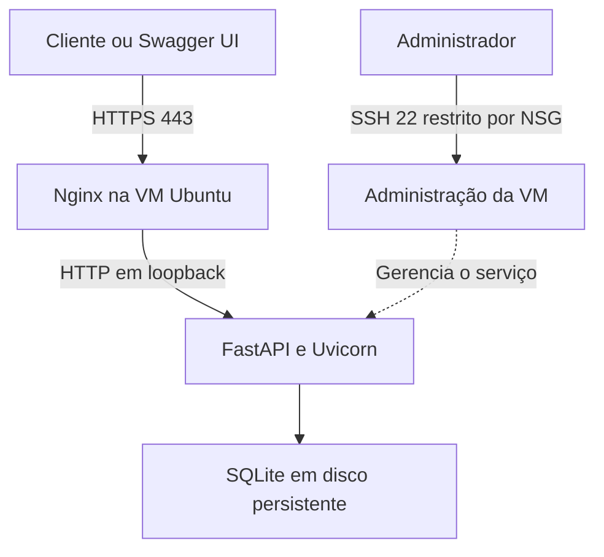
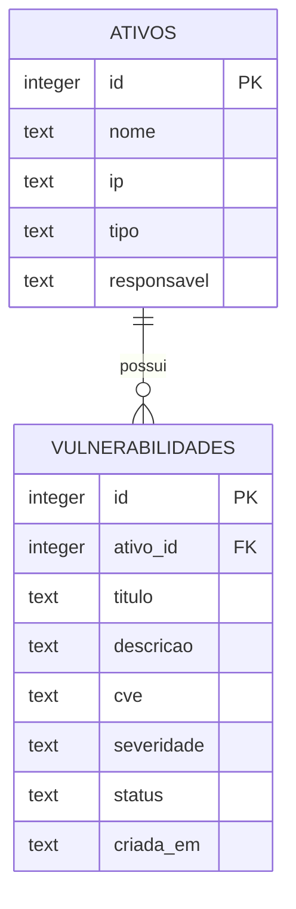

# VulnTrack

API REST para cadastrar ativos de TI e acompanhar o tratamento de vulnerabilidades. Permite relacionar cada achado ao ativo afetado, classificar sua severidade e registrar a evolução do status até a correção.

Desenvolvida em **Python com FastAPI e SQLite**, com implantação de referência em uma VM Ubuntu no **Microsoft Azure**, usando Nginx e HTTPS.

## Funcionalidades

- Cadastro, consulta, atualização e exclusão de ativos e vulnerabilidades.
- Associação de múltiplas vulnerabilidades a um ativo.
- Classificação por severidade: `baixa`, `media`, `alta` e `critica`.
- Acompanhamento por status: `aberta`, `em_tratamento` e `corrigida`.
- Filtros por ativo, severidade e status, com paginação.
- Resumo de registros por status e de vulnerabilidades pendentes por severidade.
- Autenticação por chave de API e documentação interativa com Swagger UI.
- Persistência em SQLite e bloqueio de exclusão de ativos com achados vinculados.

O VulnTrack organiza achados informados pelo usuário. Não executa varreduras, explorações ou descoberta automática de vulnerabilidades. Marcar um registro como corrigido atualiza o acompanhamento no sistema; não aplica uma correção no ativo.

## Tecnologias

| Componente | Tecnologia |
|---|---|
| API | Python 3.12, FastAPI e Pydantic |
| Servidor de aplicação | Uvicorn |
| Banco de dados | SQLite, pelo módulo `sqlite3` |
| Documentação | OpenAPI e Swagger UI |
| Implantação de referência | Azure Virtual Machines e Ubuntu Server 24.04 LTS |
| Publicação | Nginx e HTTPS configurado com Certbot |
| Gerenciamento do processo | systemd |
| Testes | unittest, TestClient e HTTPX |

## Arquitetura

Na implantação Azure, o Nginx recebe as conexões públicas e encaminha as requisições ao Uvicorn em `127.0.0.1:8000`. A aplicação valida as entradas e acessa o arquivo SQLite no disco persistente da VM.



O código é mantido neste repositório. A implantação é manual; um push no GitHub não atualiza a VM automaticamente.

## Modelo de dados



Cada vulnerabilidade pertence a um ativo existente. A chave estrangeira é habilitada em cada conexão; a exclusão de um ativo com achados vinculados retorna `409`, mesmo que esses achados estejam corrigidos. A data de criação é gerada em UTC.

O campo `cve` é opcional. Seu formato é validado, mas a existência do identificador não é consultada em uma base externa. A severidade é atribuída pelo usuário, sem cálculo automático de CVSS.

## Executar localmente

Requisitos: **Python 3.12** e **Git**. O banco é criado automaticamente na primeira inicialização.

```bash
git clone https://github.com/jjysl/vulntrack.git
cd vulntrack
```

### Windows com PowerShell

Execute os comandos abaixo no **PowerShell**, na pasta do projeto:

```powershell
py -3.12 -m venv .venv
.\.venv\Scripts\python.exe -m pip install -r requirements.txt
$env:VULNTRACK_API_KEY = & .\.venv\Scripts\python.exe -c "import secrets; print(secrets.token_urlsafe(32))"
$env:DATABASE_PATH = "data/vulntrack.db"
.\.venv\Scripts\python.exe -m uvicorn main:app --host 127.0.0.1 --port 8000
```

### Linux com Bash

```bash
python3 -m venv .venv
.venv/bin/python -m pip install -r requirements.txt
export VULNTRACK_API_KEY="$(.venv/bin/python -c 'import secrets; print(secrets.token_urlsafe(32))')"
export DATABASE_PATH="data/vulntrack.db"
.venv/bin/python -m uvicorn main:app --host 127.0.0.1 --port 8000
```

Acesse:

- Swagger UI: <http://127.0.0.1:8000/docs>
- OpenAPI: <http://127.0.0.1:8000/openapi.json>
- Saúde da aplicação: <http://127.0.0.1:8000/health>

Mantenha o processo em execução enquanto utiliza a API. As variáveis definidas nesses exemplos pertencem à sessão do terminal; os dados permanecem no arquivo SQLite após encerrar o processo.

## Autenticação e configuração

| Variável | Descrição | Padrão |
|---|---|---|
| `VULNTRACK_API_KEY` | Chave obrigatória, com pelo menos 32 caracteres | Sem valor padrão |
| `DATABASE_PATH` | Caminho do arquivo SQLite | `data/vulntrack.db` |

Envie a chave no cabeçalho **`X-API-Key`**. No Swagger, clique em **Authorize** e informe somente o valor da chave, sem o prefixo `Bearer`.

Para consultar a chave local, antes de iniciar o servidor ou após interrompê-lo no mesmo terminal, use `$env:VULNTRACK_API_KEY` no PowerShell ou `printf '%s\n' "$VULNTRACK_API_KEY"` no Bash. Não publique essa saída.

As operações de dados exigem autenticação. `/health`, `/docs` e `/openapi.json` são públicos. O programa lê variáveis de ambiente; não carrega arquivos `.env` automaticamente.

## Endpoints

| Método | Rota | Operação |
|---|---|---|
| `POST` | `/ativos` | Cadastrar ativo |
| `GET` | `/ativos` | Listar ativos |
| `GET` | `/ativos/{id}` | Consultar ativo |
| `PUT` | `/ativos/{id}` | Atualizar ativo |
| `DELETE` | `/ativos/{id}` | Excluir ativo sem achados vinculados |
| `POST` | `/vulnerabilidades` | Cadastrar vulnerabilidade |
| `GET` | `/vulnerabilidades` | Listar e filtrar vulnerabilidades |
| `GET` | `/vulnerabilidades/{id}` | Consultar vulnerabilidade |
| `PUT` | `/vulnerabilidades/{id}` | Atualizar vulnerabilidade |
| `DELETE` | `/vulnerabilidades/{id}` | Excluir vulnerabilidade |
| `GET` | `/resumo` | Consultar indicadores |
| `GET` | `/health` | Verificar acesso ao banco |

As listagens aceitam `limit` (padrão `100`, máximo `500`) e `offset` (padrão `0`). A listagem de vulnerabilidades também aceita `severidade`, `status` e `ativo_id`.

Exemplo de filtro:

```text
GET /vulnerabilidades?severidade=alta&status=aberta&ativo_id=1
```

`PUT` recebe todos os campos editáveis do registro. Não envie `id` ou `criada_em` no corpo da requisição. Em `/resumo`, `abertas_por_severidade` contabiliza os estados `aberta` e `em_tratamento`.

### Exemplo de uso

Cadastre um ativo em `POST /ativos`:

```json
{
  "nome": "Servidor Web",
  "ip": "10.0.0.10",
  "tipo": "servidor",
  "responsavel": "Equipe de Infraestrutura"
}
```

Em seguida, utilize o ID retornado em `ativo_id` ao cadastrar o achado em `POST /vulnerabilidades`. O exemplo abaixo pressupõe que o ativo recebeu ID `1`:

```json
{
  "ativo_id": 1,
  "titulo": "Divulgacao de versao no cabecalho HTTP",
  "descricao": "Cenario ficticio: cabecalho HTTP revela a versao do runtime.",
  "cve": null,
  "severidade": "baixa",
  "status": "aberta"
}
```

O `id` da vulnerabilidade é independente do `id` do ativo. Para atualizar o achado, utilize o identificador retornado no cadastro da vulnerabilidade.

### Códigos de resposta

| Código | Significado |
|---|---|
| `200` | Consulta ou atualização concluída |
| `201` | Registro criado |
| `204` | Exclusão concluída, sem corpo de resposta |
| `401` | Chave ausente ou inválida |
| `404` | Registro não encontrado |
| `409` | Ativo possui vulnerabilidades vinculadas |
| `422` | Dados de entrada inválidos |

## Testes

No Windows com PowerShell:

```powershell
.\.venv\Scripts\python.exe -m pip install -r requirements-dev.txt
.\.venv\Scripts\python.exe -m unittest -v
```

No Linux:

```bash
.venv/bin/python -m pip install -r requirements-dev.txt
.venv/bin/python -m unittest -v
```

O teste de integração utiliza um banco temporário e cobre autenticação, validação, CRUD, integridade referencial, filtros, resumo e persistência ao reabrir a aplicação. Não altera o banco utilizado na execução normal.

## Implantação no Azure

A implantação de referência utiliza:

- VM Ubuntu Server 24.04 LTS, SKU `Standard_B1s`, em `South Africa North`.
- Disco gerenciado `Standard SSD LRS`, com 30 GiB.
- Nginx com HTTPS e encaminhamento para `127.0.0.1:8000`.
- Serviço systemd executado pelo usuário dedicado `vulntrack`.
- Banco em `/var/lib/vulntrack/vulntrack.db`.
- Configuração do processo em `/etc/vulntrack.env`, com permissão `600`.
- NSG com portas 80 e 443 públicas e SSH 22 restrito ao IP do administrador.

Os modelos de configuração estão em [`deploy/vulntrack.service`](deploy/vulntrack.service) e [`deploy/nginx.conf`](deploy/nginx.conf). O modelo Nginx contém o marcador `SEU_FQDN`, que deve ser substituído pelo domínio utilizado antes da ativação. O certificado HTTPS é configurado separadamente com Certbot.

**Endereço da implantação de referência:** [Swagger UI](https://vulntrack-jjysl.southafricanorth.cloudapp.azure.com/docs). A disponibilidade depende de a infraestrutura Azure estar ligada; a execução local permanece disponível por este repositório.

## Estrutura do projeto

| Arquivo | Conteúdo |
|---|---|
| `main.py` | Modelos, rotas, autenticação e acesso ao SQLite |
| `requirements.txt` | Dependências de execução |
| `requirements-dev.txt` | Dependências para testes |
| `test_api.py` | Teste de integração |
| `deploy/vulntrack.service` | Unidade systemd |
| `deploy/nginx.conf` | Modelo inicial do proxy Nginx |
| `docs/VALIDACAO_LOCAL.md` | Registro da validação local do pacote |

## Segurança e limites

Os valores recebidos são vinculados às consultas SQL por parâmetros. A validação rejeita campos extras e valores fora dos domínios definidos. O diretório de dados fica separado do código na implantação de referência.

A autenticação usa uma chave compartilhada, sem contas individuais, RBAC ou trilha de auditoria. O ambiente não implementa alta disponibilidade nem migrações de esquema. O uso de SQLite e uma única instância é adequado ao escopo demonstrativo; capacidade e concorrência exigem avaliação antes de ampliar a carga.

Mantenha chaves, arquivos de banco e backups fora do repositório. O `.gitignore` inclui essas exclusões. A execução de `CREATE TABLE IF NOT EXISTS` não atualiza o esquema de tabelas existentes.

## Autor

**José Rodrigues** — projeto acadêmico da disciplina de Cloud Security, FIAP.
